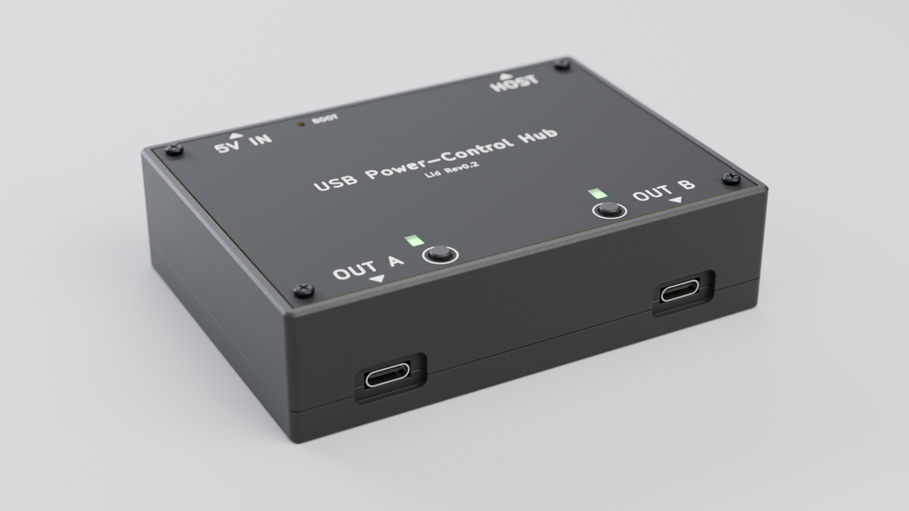
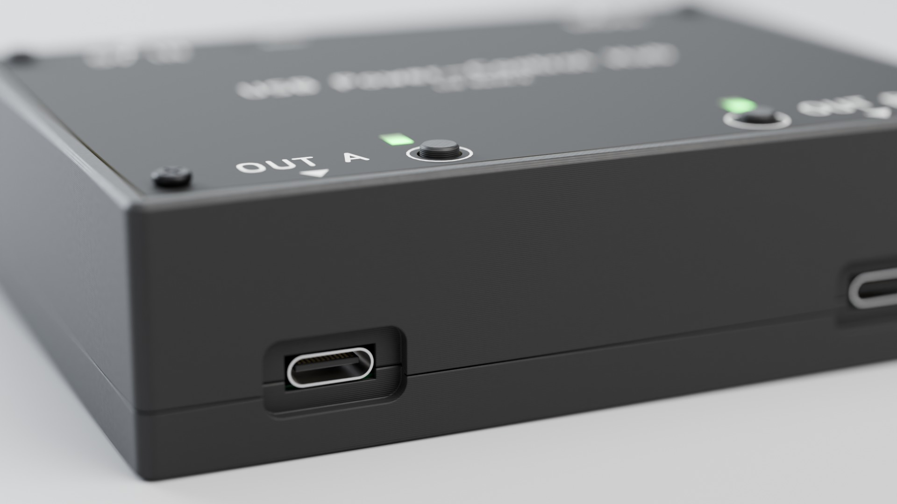
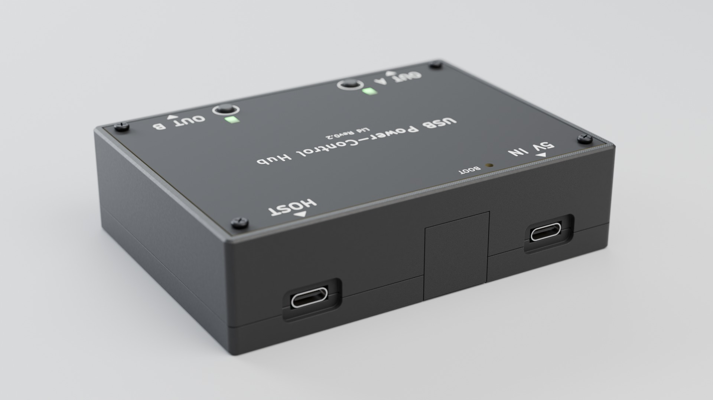
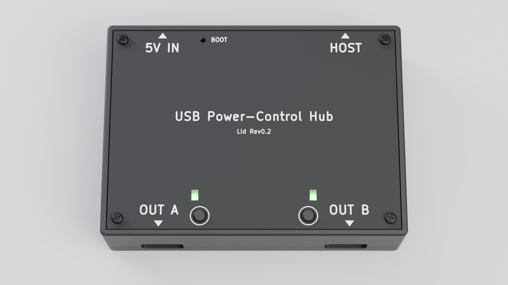

# USB Power-Control Hub

A 2-channel switched USB-C hub that measures each downstream port's current from
0.1 µA to 1 A, so a device under test can be power-profiled and power-cycled from
the host PC over a plain COM port.



*A rendered picture of the design files, not a photograph: nothing is printed or assembled
yet. [What it looks like](#what-it-looks-like) explains each face.*

> **Status (2026-11-21): the main board is ordered and in production. Nothing is built or
> measured, and there is no firmware.**
>
> - **Main board, Rev0.7 r01: `ORDERED`.** The user ordered it from JLCPCB and paid for it on
>   2026-11-20 (5 boards, 2 of them assembled) and had the production file confirmed on
>   2026-11-21. Its files are `manufacturing/releases/rev0.7/r01/` and are never overwritten.
>   It went out with gates open: JLCDFM never ran on Rev0.7, the stackup was not named on the
>   order, and the open issues of `CLAUDE.md` Section 11 stand (`RELEASE_MANIFEST.md` there,
>   *Open gates*). Its solder mask is green: JLCPCB takes only green on an Economic 4-layer
>   order.
> - **Enclosure, Rev0.5: drawn, not printed.** A printed tray, frame and cover with a PCB lid
>   let into the frame (`design/mechanical/`). No cable has been tried in an opening.
> - **Lid PCB, Rev0.2: drawn, not ordered.** JLCPCB has not seen its files.
> - **Firmware: does not exist.** The PC software (`host/profiler/`) runs against its demo
>   device.
> - **Every other release** (`manufacturing/releases/rev0.4/` to `rev0.6/`) stays `WIP` and
>   is not orderable. No further order is placed without the user's approval.

## What it is meant to do

- **Two USB-C inputs:**
  - `HOST` (J1) carries data and logic power from the PC.
  - `5V IN` (J4) is a power-only 5 V input that feeds the ports. Its USB-C current
    advertisement is read and enforced.
  - There is no USB-PD and no port regulator: the port voltage is J4's minus up to 0.40 V
    at 1 A (0.48 V when the other port also draws 1 A; the input fuse is shared).
- **Downstream:** two USB-C receptacles (`OUT A`, `OUT B`), each switched on and off
  independently by firmware. They are OFF at power-up and after any reset (REQ-PORT-01),
  and offer Default USB power (500 mA), with a hardware over-current trip at 1.16 A. Each
  port's D+ and D− are also tapped through 1 kΩ to four RP2040 GPIO for a Low-Speed and
  Full-Speed capture of the device under test (D38, issue #10); firmware for it does not exist.
- **Measurement:** per port, a 3-range shunt ladder (510 Ω / 10 Ω / 0.1 Ω) with hardware
  up-ranging, discrete current-mirror amplifiers, and two 12-bit MCP3208 ADCs (one per
  port, sampled together), at 14.0 kSPS per channel. Accuracy target: ±(1 % + 3 LSB of the range).
- **Control:** an RP2040 with its own flash and crystal, machine-placed (D29), behind a CH335F hub, also machine-placed (D31), enumerating as a driverless CDC-ACM COM
  port. Commands such as `PORT A ON`, `PORT B CYCLE 2000` and `STREAM ON` are listed in
  `requirements/product.md` Section 4.1.
- **Board:** 100 × 72 mm, 4 layers, 1.6 mm FR-4 (D24), leaded HASL (D30). The earlier 85 × 35 mm
  cannot hold the Rev0.4 parts. JLCPCB's instant quote on 2026-11-03 (4 layers, 5 pcs,
  default options, leaded HASL) was $8.00 at 85 × 35, 100 × 72 and 100 × 100 mm; ENIG would
  add $16.90 and $17.40 at the two sizes. Recheck the live quote before ordering. The stackup is
  JLC04161H-7628, named on the order, without impedance control for the prototype (D27).
  - JLCPCB machine-places the small parts, the RP2040, the CH335F and the four USB-C
    receptacles, all JLCPCB **Basic** except those three parts (Extended, the user's three
    exceptions, D29, D31 and D37).
  - You hand-solder the large parts, all bought from **Akizuki**: two DIP16 ADCs, the 12 V
    module, two shunts per port and the input fuse.
  - This is the sourcing rule D13. D22 excludes Preferred Extended parts too, so the
    D+/D− lines of J1–J3 have no ESD protection (`requirements/product.md` §9).

## What it looks like

The unit is 104.8 × 76.8 × 27.7 mm, everything matte black (Enclosure E2, Lid K7). The
pictures are rendered from the generated design files: the enclosure's STL files and the lid's
KiCad board. They are not photographs and they prove nothing. Nothing is printed, the lid PCB
is not ordered, and the screws, the receptacles and the lit LEDs are drawn by the render
script.

| Front | Back |
|---|---|
|  |  |
| `OUT A` (left) and `OUT B` (right), the two switched and measured ports, 65 mm apart. Each opening has a 15.0 × 8.0 mm pocket for the plug's overmould (E6). The line along the wall is the seam between the tray below and the frame above. | `HOST` (data and logic power from the PC) and `5V IN` (the power-only input that feeds the ports). The flat piece between them is the printed cover (E11) of the opening for the SWD spring-pin clamp (J5, D40): it is drawn out with a fingernail before the clamp goes on. |



The top is a PCB, not a printed part (Lid Rev0.2: bare 2-layer, 1.6 mm, matte black mask,
white legend, no component and no net).

1. **It lies inside the case.** The frame's wall goes on up round the lid, as high as the
   lid is thick, so the lid's edge is not seen and its top face is flush with the wall's
   (E12; 0.4 mm between lid and wall).
2. **Four M2 screws** hold it on the frame's posts; four more from below clamp the main board
   between tray and frame (E4, heat-set inserts).
3. **A label and an arrow for each port:** `HOST`, `5V IN`, `OUT A`, `OUT B`.
4. **A button and a window beside each output.** The button is a loose printed plunger over
   the port's switch on the main board. The window is bare FR-4, with no copper and no mask,
   over the port's two LEDs (green: port on, red: port fault), so no light pipe is needed (E8).
5. **`BOOT` is a pinhole** for a paperclip to SW3, which starts the RP2040's USB bootloader
   without opening the case (REQ-BOOT-02).

What is not known before a print (the lid's fit in its pocket, how the support under the
lid's seat comes off, the cover's click, a real cable in an opening) is listed in
`design/mechanical/ENCLOSURE_Rev0.5.md` §10. To draw the pictures again, with Blender 5.x and
KiCad 9.0 (about 1 min on a GPU):

```sh
"<Blender>/blender.exe" -b --python design/mechanical/scripts/render_unit.py -- --kicad-cli "<KiCad 9.0>/bin/kicad-cli.exe"
```

## Documents

Read in this order:

| File | What it holds |
|---|---|
| `CLAUDE.md` | Engineering policy, release discipline, and the open-issue list (Section 11). Every unstruck open issue blocks manufacturing. |
| `requirements/product.md` | What the product must do — the authority. REQ-* IDs, each marked Settled / Delegated / Proposed / Open / Withdrawn. Includes the control protocol. |
| `requirements/verification.md` | How each requirement is proven (V-* IDs: method, pass criterion, limits). |
| `design/circuit/CIRCUIT_DESIGN_Rev0.7.md` | The schematic as a document: topology, nets, designators, calculations, decisions (§10), and what was given up to meet the sourcing rule (§7.4). Rev0.1–Rev0.4 are in Git history (Rev0.4 at commit `5a697aa`). |
| `requirements/parts.md` | Candidate parts: JLCPCB Basic rows (LCSC number, assembly stock, class, date) and Akizuki rows (code, stock, price, date). Candidates only — none is confirmed. |
| `design/ecad/` | The KiCad 9 project (D32): `source/` holds the project, the source of truth until the EasyEDA import; `scripts/` holds its generators and checks; `libraries/` holds the project's symbols and footprints and the parts register they are checked against (its README). So far: stackup, outline, rules, net classes, the libraries, the schematic, written from `design/circuit/CIRCUIT_DESIGN_Rev0.7_netlist.md` (the capture list: every part, pin and net) and checked against it, the placement and silkscreen, written from `design/ecad/PLACEMENT_Rev0.7.md` (where every part and label sits, and why), and the routing, from `design/ecad/ROUTING_Rev0.7.md`; `make_outputs.py` writes the candidate manufacturing set from the board. `design/ecad/README.md` gives the order to run the generators in. |
| `design/experiments/oi-23-placement/` | The OI-23 placement study: why 85 × 35 mm cannot work, and the checked 100 × 72 mm block placement. A trial, not design data. |
| `design/experiments/stackup-impedance/` | The stackup study behind D27: JLCPCB's 4-layer stackups, the 90 Ω USB pair width on each, and a model checked against JLCPCB's single-ended calculator. A non-authoritative study, not design data. |
| `design/experiments/cost-estimate/` | Prototype cost estimate, dated 2026-11-03, re-run 2026-11-04 for D29, D30, D31 and D33, with Rev0.4's real quote (2026-11-12), the Rev0.5 delta for D37 and D38 and Rev0.5's quote (2026-11-13): 5 bare PCBs with 2 assembled by JLCPCB, plus the Akizuki parts. An estimate, not a quote. |
| `design/experiments/usb-symmetry-c2/` | Trial C2 (issue #12): the four USB-C receptacles and the two buttons mirrored about the board's centre line, at placement level and, without a patch, at routing level. The parts fit and `check_pcb.py` passes on a footprint-only board; one router run left 15 connections open, against 16 on the board at the same stage. A trial, not design data. D39 then took its placement into the board as Rev0.6 (issue #13); the board's routing is its own (`design/ecad/ROUTING_Rev0.7.md`), not the trial's. |
| `design/mechanical/` | The enclosure (issue #11; Rev0.5 for the Rev0.7 board, issue #14), a first design on paper: `ENCLOSURE_Rev0.5.md` (a printed tray and frame with a PCB lid let into the frame, 104.8 × 76.8 × 27.7 mm; its decisions E1–E12, the opening for the SWD clamp, its printed cover and the wall round the lid among them, and what is not verified), the board's mechanical interface exported from the KiCad board, the STL files, eleven pictures of the build, four realistic renders of the assembled unit (`render_unit.py`, for looking at), and the scripts that generate and check them (its README). Nothing is printed and no cable has been tried. The lid PCB is drawn as its own KiCad board (`LID_Rev0.2.md`, `lid/`: bare 2-layer, the main board's outline, the legend on its top); it is not ordered. |
| `host/profiler/` | The PC software (issue #9): a native Win32 current profiler in Rust that plots both channels, switches the ports and exports CSV. Runs against its demo device until firmware exists (its README). |
| `mockup/` | three.js appearance model of an earlier 60 × 24 mm, 6-layer concept. Reference only; superseded by the board-size decisions D10 and D24 (100 × 72 mm). |

Decisions are D-numbers in the circuit document's §10. Its "By" column says whether the
user made each one, whether it came from the Rev0.1 design, or whether Claude made it
under the user's 2026-11-03 delegation ("Claude (delegated)"). The user may revert a
delegated decision. Rev0.2's proposals (P-numbers) are resolved in §14.

## Re-checking part stock

Stock in `requirements/parts.md` is a dated snapshot. To re-query the JLCPCB
assembly-parts pool (Python 3, standard library only, no install step; checked with 3.13):

```sh
python tools/jlc_stock.py C7433 OP07CDR
python tools/jlc_stock.py --all OP07      # list every hit, for finding candidates
```

The full command for every listed part is at the top of `requirements/parts.md`.
Exit status: 0 = every query matched exactly, 1 = some query did not, 2 = the API
failed. The tool's docstring lists what it cannot see — electrical suitability,
order-time stock, footprints, price, and lifecycle. Akizuki stock has no tool: read the
product page (codes in `requirements/parts.md`) at order time.

## Viewing the mockup

The mockup loads three.js from unpkg, so it needs a network connection and an
HTTP server (ES modules do not load from `file://`):

```sh
python -m http.server 8000 --directory mockup
# then open http://localhost:8000/usb-power-hub-board.html
```

## Building and programming

Not possible yet: the first boards are in production at JLCPCB (Rev0.7 r01, ordered on
2026-11-20; `manufacturing/releases/rev0.7/r01/`, state `ORDERED`), and firmware does not
exist. What follows is how the design came to that order; the gates it names are Rev0.5's and
Rev0.6's. The board is captured and laid out in KiCad 9.0.8 until the design is
complete, then imported into EasyEDA (decision D32, issue #6). Every part has a symbol and
a footprint, the RP2040's, the CH335F's and the USB-C receptacle's lands drawn from their
datasheets or maker's drawing (G20, G21, D37). The schematic is captured (issue #6 P2,
D34) and includes J1's soft start (D35, issue #7) and the four data-line taps (D38, issue
#10). The parts are placed (P3) and routed (P4, under D36's L3/L4 rule): DRC reports 0
violations and 0 unconnected items, and `check_routing.py` rule 9 keeps the L2 plane whole
under U1 and U6. Rev0.6 moved 31 parts with the connectors (D39) and carries Rev0.5's routing
where it still stands (`design/ecad/scripts/carry.py`); the rest is a new router session and
a new patch. Rev0.7 changes J5's land (D40) and carries Rev0.6's routing the same way, with the
tracks at J5 drawn in the routing document. The silkscreen labels are placed, and a candidate manufacturing set (P5:
Gerber, drill, JLCPCB BOM and CPL, schematic PDF, renders, a `WIP` manifest) is generated
into `manufacturing/working/rev0.7/`, which Git does not track and nobody may order from;
`manufacturing/releases/rev0.5/r02/` holds Rev0.5's files as a release candidate (state
`WIP`, nothing ordered; r01 beside it is superseded). The JLCPCB gate ran on 2026-11-13
(JLCDFM, part mapping, the placement preview of the receptacle, a quote of $51.94 without
shipping; `JLCPCB_REVIEW.md`) and found two defects in r01, both fixed in r02: the receptacle's
JLCPCB model sat 1.375 mm off the CPL point, and eight vias stood 0.046 mm from its plated
slots. The decisions it leaves are the user's (the 0.60 mm slot width, impedance control,
shipping, approval); then comes the EasyEDA import (P6). The front-end checks are made on the first assembled board, not on a
bench beforehand (decision D28). Firmware does not exist.

The KiCad project, its libraries, its schematic and its board are generated, not hand-edited. With KiCad
9.0's own Python, from the repository root:

```sh
"<KiCad 9.0>/bin/python.exe" -I -B design/ecad/scripts/make_project.py           # writes and checks design/ecad/source
"<KiCad 9.0>/bin/python.exe" -I -B design/ecad/scripts/test_make_project.py      # the check's negative tests
"<KiCad 9.0>/bin/python.exe" -I -B design/ecad/scripts/make_libraries.py         # writes and checks design/ecad/libraries
"<KiCad 9.0>/bin/python.exe" -I -B design/ecad/scripts/test_check_libraries.py   # its negative tests
"<KiCad 9.0>/bin/python.exe" -I -B design/ecad/scripts/make_schematic.py         # writes the schematic, runs ERC and check_schematic.py
"<KiCad 9.0>/bin/python.exe" -I -B design/ecad/scripts/test_check_schematic.py   # its negative tests
"<KiCad 9.0>/bin/python.exe" -I -B design/ecad/scripts/autoroute.py --java <java.exe> --jar <freerouting-2.5.0.jar>  # only when its input changed
"<KiCad 9.0>/bin/python.exe" -I -B design/ecad/scripts/make_pcb.py               # places, routes and labels; runs check_pcb.py, check_routing.py, check_silk.py
"<KiCad 9.0>/bin/python.exe" -I -B design/ecad/scripts/test_check_pcb.py         # its negative tests
"<KiCad 9.0>/bin/python.exe" -I -B design/ecad/scripts/test_check_routing.py
"<KiCad 9.0>/bin/python.exe" -I -B design/ecad/scripts/test_check_silk.py
"<KiCad 9.0>/bin/python.exe" -I -B design/ecad/scripts/make_outputs.py           # writes manufacturing/working/rev0.7, runs check_outputs.py
"<KiCad 9.0>/bin/python.exe" -I -B design/ecad/scripts/test_check_outputs.py     # its negative tests
```

`make_project.py` writes a bare board, so `make_pcb.py` runs after it. `autoroute.py` needs
Freerouting 2.5.0 and a Java runtime, which are not in the repository
(`design/ecad/README.md`). A release candidate is also read against the board by two scripts that
share nothing with the generators, `independent_check_sets.py` and
`independent_check_positions.py` (`design/ecad/README.md`, *Independent check of a candidate set*).

## Repository

- Git since 2026-11-03. Commit `4dd10fb` is the design exactly as it was paused
  on 2026-08-16; later commits are the 2026-11-03 revision.
- **Remote:** `origin` is the GitHub repository `tsuyoshi-otake/usb-power-hub`, private from
  2026-11-03 and public since 2026-11-20 by the user's decision, under the MIT licence
  (`LICENSE`). No account data, credential or address goes into it (`CLAUDE.md` Section 2).
- Commit messages are English and describe the change in detail.
