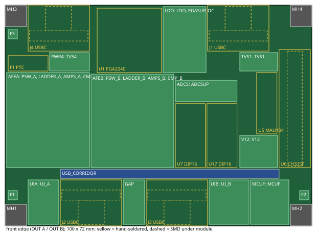

# OI-23 placement study (Rev0.4) — non-authoritative

**Question.** Does the Rev0.4 part set fit on the board? This is OI-23. D10 fixed the board at
85 × 35 mm before Rev0.3/Rev0.4 moved the large parts onto Akizuki modules and DIP packages.

Re-run 2026-11-04 for D29: the PGA2040 module is replaced by a bare RP2040 (U1), its flash
(U8) and crystal (Y1), all SMD in a new region R_MCU where the module sat. Re-run the same
day for D31: the Akizuki CH335F module is replaced by the bare chip (U6), SMD with Y2 and its
capacitors in a new region R_HUB, the right-edge strip the module held. The answers did
not change.

Re-run the same day for D33: the USB-C modules sit on PH-1x40SG pin headers, whose
insulator is 2.50 mm (≥ 2.30 mm), and the space under the modules is now read off the
Akizuki module drawing and the Hirose receptacle drawing. The layout puts the under-module
parts in a strip that avoids the receptacle, which hangs below the module. The area bound
credits each module's whole outline less its header insulators, which is larger than the
earlier credit, so the first answer is now conditional. The figures below are the D33
re-run's.

**Answer.**
- **No: 85 × 35 mm cannot hold Rev0.4 with any routing space from 2.5 % of the courtyard
  area up (K ≥ 1.025).** With none at all (K = 1.0), the bound is 1.5 % below the board's
  area, so area alone no longer proves it. No layout routes at K = 1.0.
- A block placement at **100 × 72 mm** passes every check below.
- D24 (2026-11-03) adopts 100 × 72 mm. The user's condition was 「100x100未満ならいいんだっけ」:
  stay inside JLCPCB's 100 × 100 mm price tier. The size inside it came from this study
  (CIRCUIT_DESIGN_Rev0.4.md §10).

This directory is a trial, not design data (CLAUDE.md §2: `design/experiments/` is
non-authoritative). The block positions are a proposal. Nothing here is a footprint, an
outline drawing or a layout.

The placement that issue #6 P3 made from this proposal is `design/ecad/PLACEMENT_Rev0.4.md`;
its *Deviations from the study* lists where the real footprints did not fit these blocks.

## Files

| File | What it is |
|---|---|
| `placement_study.py` | The study. Standard library only: `python -I design/experiments/oi-23-placement/placement_study.py --svg layout_100x72.svg`. Exits 1 if a layout check fails. |
| `test_placement_study.py` | 21 tests. Sixteen corrupt one aspect of the layout, the header or the module geometry and expect the checker to name the failure (CLAUDE.md §8); one checks that the unchanged layout passes; four check the area bound: its printed terms add up, only low parts earn the under-module credit, the space under a module is its outline less the header insulators, and the K from which it exceeds 85 × 35 mm. |
| `layout_100x72.svg` | The block placement, drawn by the script. The front edge (OUT A / OUT B) is at the bottom. |

## Result 1 — 85 × 35 mm is too small for any routing allowance from K = 1.025

The script adds up three things:
- every courtyard, both the hand-soldered parts and the SMD;
- the four mounting-hole keepouts;
- the routing space, as a factor K.

From that total it subtracts the most favourable under-module credit: every single SMD part
no taller than 1.5 mm may sit under a raised module, up to the space there is. The result is
a lower bound on the board area any layout would need.

| K (region area per courtyard area) | Needed | Against 85 × 35 (2,975 mm²) |
|---:|---:|---:|
| 1.0 (no routing space at all) | 2,931 mm² | 0.99 × |
| 1.4 | 3,660 mm² | 1.23 × |
| 1.6 (planning value) | 4,025 mm² | 1.35 × |
| 2.0 | 4,754 mm² | 1.60 × |

K = 1.0 is physically impossible to build: it leaves no room for a single trace. There the
bound is 2,931 mm², 1.5 % under the board's area; from K = 1.025 it exceeds it. Every real
layout needs more routing space than that, so 85 × 35 mm stays excluded, but the K = 1.0 row
is not a proof on its own.

Before D33 the bound credited only 130 mm² under each USB-C module and gave 3,332 mm²
(1.12 ×) at K = 1.0, which this README called a proof. That credit was not the most
favourable one, so the figure was not a lower bound. The earlier figures used the same
credit: 3,780 mm² (1.27 ×) before D29, with the PGA2040, and 3,518 mm² (1.18 ×) before D31,
with the CH335F module.

The inputs:
- **Hand-soldered: 1,806 mm².** Four USB-C modules at 20 × 15 mm (Akizuki drawing), two
  DIP16 at 9.8 × 20.85 mm, the MAU104 at 20 × 6.6 mm, and the F1 input fuse at 13 × 5 mm
  (MF-R300, D25). The PGA2040's 21 × 21 mm left with D29, and the CH335F module's
  38.5 × 10.2 mm with D31.
- **SMD courtyards: 1,850 mm².** This includes the four hand-soldered shunts (133 mm²). The
  count is 151 × 0402, 41 × SOT-23, 9 × SOIC-8, one QFN-56 (U1, 8.25 × 8.25 mm from the
  RP2040 datasheet's 7.75 mm pad span), one QFN-28 (U6, 5.25 × 5.25 mm: the CH334/335
  datasheet's 4.0 mm body with U1's 0.375 mm pad extension and a 0.25 mm margin), one SOIC-8
  208 mil (U8, 9.6 × 5.88 mm from the Winbond drawing), and the rest as listed in the script.
- **Space under modules: 921 mm²,** all of it credited: the parts no taller than 1.5 mm would
  fill 1,116 mm² even at K = 1.0. That is 230.2 mm² under each USB-C module: its
  20 × 15 mm outline less the PH-1x40SG insulators of its 1 × 7 row (17.78 × 2.50 mm) and
  of its two 1 × 2 mechanical pieces (5.08 × 2.50 mm each). It includes the receptacle zone.
  There the Hirose CX70M-24P1 hangs below the module by 2.36 mm less the module board's
  thickness, which Akizuki does not publish, so whether a 1.5 mm part fits there depends on
  that thickness. Counting it is the most favourable reading, which keeps the bound a bound.
  Before D33 the credit was 519 mm²: 130 mm² per module, part of it under the receptacle.
  The CH335F module's 184 mm² between its pin rows left with it (D31).

Rev0.4 §11 had estimated the SMD content at 1,100–1,200 mm² without counting it. The count
gave 1,516 mm² excluding the shunts before D29, 1,695 mm² with U1's circuit, and gives
1,717 mm² with U6's (D31).

## Result 2 — a block placement at 100 × 72 mm

**Front edge:**
- OUT A (J2) and OUT B (J3) at a 28 mm pitch;
- a button and LEDs beside each port;
- SW3 (BOOT) and the TC2030 SWD land at the right.

**Behind the ports:**
- a 3 mm USB corridor, kept free of parts, carries D± from the hub (U6, in R_HUB) to J2
  and J3;
- the corridor runs in front of the analog front end, not through it.

**Analog band:**
- each port's front end (port switch, shunt ladder, amplifiers, comparators) in one
  27 × 31 mm region;
- the two MCP3208 ADCs beside them.

**Right column:**
- R_HUB, the right-edge strip from the corridor to J1 (10.2 × 38.5 mm, 22 % used at
  K = 1.6): U6 (CH335F), Y2 and U6's three capacitors. The rest of the strip is left for the
  upstream pair from J1;
- the MAU104, 6.4 mm from the nearest ADC.

**Back edge:**
- PWR IN (J4) at the left, with the input fuse F1 in front of it, and HOST (J1) at the right;
- U1 (RP2040), U8 and Y1 between them in R_MCU (23 × 21.5 mm, 62 % used at K = 1.6), with
  the LDO and the OC comparator next to it.

Under the modules: the port-side parts (discharge FET, port capacitor, CC ESD, Rp) sit under
J2 and J3, and the input parts under J4 and J1. Only parts no taller than 1.5 mm go there.
Since D33 they go in one 19.0 × 3.4 mm strip per module (65 mm²), between the shell tabs
and the 1 × 7 header insulator, where the whole insulator height is free. Nothing goes
under the receptacle. The port blocks fill 80 % of the strip at K = 1.6.

Checks that pass:
- every rectangle lies inside the board with ≥ 0.3 mm to the edge;
- no two rectangles are closer than 0.5 mm;
- every block is placed exactly once;
- the header's lowest insulator, 2.30 mm, leaves 0.80 mm above a 1.5 mm part (≥ 0.5 mm
  required, D33), and each module's under-module strip clears its header insulators, its
  receptacle, the receptacle's pins and its shell tabs;
- J1 and J4 sit on the back edge, J2 and J3 on the front edge; the J2–J3 pitch is
  28 mm (≥ 20 mm);
- the MAU104 keeps ≥ 6 mm from the front ends and the ADCs;
- the USB corridor reaches R_HUB, J2 and J3, and crosses neither front-end region;
- every region holds its blocks at K = 1.6. The layout holds up to **K = 1.74**, set by the
  port B front-end region (92 % full at K = 1.6).

## What this study cannot see

- **Routing.** K is a planning assumption. Only capture and layout show that a region routes.
  The front-end regions are the tight ones.
- **Real footprints.** The courtyards are IPC-7351-nominal planning values. The passive
  counts come from the Rev0.4 circuit text and `requirements/parts.md`; capture will number
  them.
- **Footprints of the bare chips.** U1's, U6's and U8's courtyards are derived from their
  package drawings, not from footprints (Rev0.4 G20, G21). Since D31 no outline in the study
  comes from a photo; the CH335F module's did (OI-24, closed by D31).
- **The link from CH335F port 1 to U1, and the upstream pair from J1 to U6.** Neither has a
  corridor of its own: both share the routing allowance K. Only the HS corridor to J2 and J3
  is checked.
- **Placement inside a region.** For example, it does not check that the shunt ladder keeps
  away from the USB corridor, or that the 12 V trace from the MAU104 reaches the front ends
  cleanly.
- **The USB-C module's board thickness, and the receptacle's overhang.** Akizuki publishes
  no thickness, so how far the receptacle hangs below the module is unknown, and the layout
  keeps that zone empty. The receptacle overhangs the module's front edge by 1.06 mm (module
  drawing), so with the module flush with the board edge it stands 1.06 mm outside the
  outline. Both are enclosure questions (V-MECH-01).
- **Mechanical, thermal and EMC behaviour.** It checks no heights except the under-module
  rule. The enclosure, the lid PCB and the mockup all follow the board size and must be redone
  if it changes.
- **Cost.** The script computes none. The JLCPCB instant quote was read by hand on
  2026-11-03 (4 layers, 5 pcs, default options): $8.00 at 85 × 35, 100 × 72 and
  100 × 100 mm, and $30.80 at 130 × 72 mm. ENIG adds $16.90 at 85 × 35 mm and $17.40 at
  100 × 72 mm. Prices change; recheck the live quote at every release (CLAUDE.md §9).
