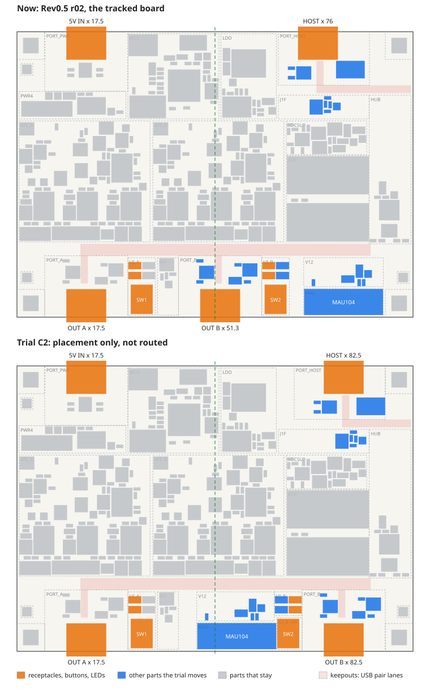
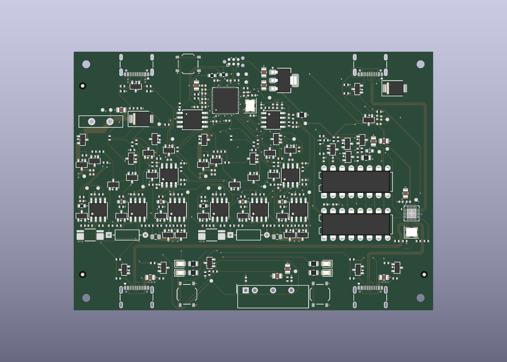

# Trial: a mirror-symmetric USB connector placement (C2, "four corners")

> **Non-authoritative (issue #12).** Nothing here is the board. The board's placement is
> `design/ecad/PLACEMENT_Rev0.5.md`, its release candidate is Rev0.5 r02, and this trial changes
> neither. It answers two questions. At placement level (2026-11-18): do the parts fit if the
> connectors mirror? At routing level (2026-11-19, section "Routed"): what does the router leave
> open on that placement, beside what it left open on the board?

## Why

Looking at the lid PCB's legend (issue #11) the user wrote 「なんかUSBの位置がアシンメトリーで変だね」,
chose 「再配置を検討」, and after a block-level desk study chose 「C2 を試し配置」 (2026-11-18).

The lid copies the main board's connector positions, so the asymmetry is the main board's. `x` in
mm, the board is 100 mm wide, a mirrored pair adds up to 100:

| Pair | Now (Rev0.5 r02) | Sum | C2 | Sum |
|---|---|---:|---|---:|
| Front: OUT A (J2) / OUT B (J3) | 17.5 / 51.3 | 68.8 | 17.5 / 82.5 | 100.0 |
| Back: 5V IN (J4) / HOST (J1) | 17.5 / 76.0 | 93.5 | 17.5 / 82.5 | 100.0 |
| Buttons: SW1 / SW2 | 31.5 / 65.3 | 96.8 | 31.5 / 68.5 | 100.0 |
| LEDs: D10, D11 / D12, D13 | 29.75 / 63.55 | 93.3 | 29.75 / 70.25 | 100.0 |

## What C2 changes

31 of the 304 parts move; `c2_change.py` is the one home of their positions.

- **OUT B** (J3 and its 7 port parts) goes to the front right, channel A's port moved by 65.0 mm.
  Its button and LEDs (SW2, D12, D13, R240, R241) mirror OUT A's.
- **The MAU104** (U5) and its 6 parts leave the front right for the front middle, 26.95 mm left.
- **HOST** (J1, its 4 port parts, the 6 parts of its soft start) goes 6.5 mm to the right.
- Channel A, both front ends, the ADCs, the reference, the hub, the MCU and the 5 V input stay.



## Result (2026-11-18)

**The parts fit.** `check_pcb.py` on the C2 board: 13,690 checks, 0 failed. Every `at` and
`next to` note of the placement document and of the capture list holds, no courtyard leaves its
region or enters a keepout, and DRC reports no violation between footprints.

What had to give:

1. **The MAU104 has a window 0.39 mm wide.** At x 47.85 its courtyard is 6.15 mm from R11 in the
   reference block (the rule is ≥ 6.0 mm) and 0.21 mm from SW2's courtyard. The desk study's
   "1.4 mm short" came from region rectangles; the parts themselves leave this window.
2. **UI_B is two rectangles** (`UI_B` for the LEDs, `UI_B_SW` for the button): the MAU104's
   courtyard passes below the LED resistors' courtyards and beside the button's.
3. **D5** (J1's TVS) moves 5.15 mm, not 6.5 mm, so that it stays left of the corner block of the
   mounting hole H4, and 0.65 mm down, so that its legend clears J1's pin-1 mark.
4. **Thirteen pairs leave the channel table.** Channel B's port and button are no longer
   "channel A + 33.8 mm"; both front ends still are.
5. **D12, D13 and their resistors are turned half a turn**, so that the LED's anode still faces its
   resistor. The LEDs of OUT B then point the other way than those of OUT A.

Distances, from `trial.py`. Courtyard to courtyard, mm:

| The MAU104 to the nearest part of | Now | C2 |
|---|---:|---:|
| REF (the V_INJ reference) | 32.34 | **6.15** |
| AFE_B | 13.88 | 11.93 |
| AFE_A | 42.60 | 18.35 |
| ADC | 11.95 | 12.23 |
| ADCSUP | 33.91 | 34.14 |

Pad to pad on one net, straight line, mm (not a track length):

| Net, from → to | Now | C2 | Change |
|---|---:|---:|---:|
| VBUS_B, shunt ladder (RS22) → OUT B | 14.72 | 26.68 | +12.0 |
| USB pair B, hub → OUT B | 47.05 | 22.25 | −24.8 |
| USB pair A, hub → OUT A | 77.26 | 77.26 | 0 |
| USB upstream pair, HOST → hub | 42.37 | 39.77 | −2.6 |
| V5L, J1's soft start → the MAU104 | 46.47 | 57.69 | +11.2 |
| V12F, its filter → channel A front end | 62.00 | 37.83 | −24.2 |
| V12F, its filter → channel B front end | 32.39 | 21.41 | −11.0 |

Read against CLAUDE.md §1, where measurement accuracy ranks above visual refinement: C2 shortens
the Hi-Speed pair of OUT B and the 12 V feed of both front ends, and it puts the switching
converter 6.15 mm from the reference that injects the pedestal into all six amplifiers, where it
is 32 mm away today. Whether that costs accuracy is a measurement on a built board, not something
this trial can say.

## Routed (2026-11-19)

Asked whether to try the routing as well, the user answered 「単純作業はDevin SWE-2 Maxを利用して。」
(2026-11-19), read here as: go on, with the simple work delegated. The trial is still
non-authoritative: the board, its routing document, its router session and Rev0.5 r02 are
unchanged, and everything below was built in a scratch directory outside the repository.

**C2 routes about as well as the board did at the same stage, and neither is finished.** The
router left 15 connections open on C2 and 16 on the board; both need a patch after it.

### What is compared

`route_trial.py` builds two boards, both without silkscreen labels and both without a patch:

- **Board**: the board's own documents with the patch table emptied, and the committed router
  session. It is the board as the router left it, before the 275 patch rows of
  `ROUTING_Rev0.5.md`. Its 16 open connections and 11 D36 places are the figures CLAUDE.md §0
  gives for the committed session.
- **C2**: the placement changed by `c2_change.py`, the routing document by `c2_routing.py`, and a
  new session of the same router (Freerouting 2.5.0, the same arguments, at most 60 passes).

| | Board (committed session, no patch) | C2 (new session, no patch) |
|---|---:|---:|
| Router passes | 40 | 41 |
| The router's own unrouted count | 55 | 53 |
| DRC unconnected items | 16 | 15 |
| D36 places (`FAIL analog`) | 11 | 14 |
| Tracks / vias | 2,215 / 343 | 2,270 / 344 |
| Port A copper path (limit 40 mΩ) | 35.24 mΩ | 35.24 mΩ |
| Port B copper path (limit 40 mΩ) | 37.89 mΩ | 38.64 mΩ |
| `check_pcb.py` failed | 5 | 11 |
| `check_routing.py` failed | 40 | 48 |

`check_routing.py` FAIL lines by subject:

| Subject | Board | C2 | What it is |
|---|---:|---:|---|
| `DRC` | 5 | 11 | board: 5 `track_dangling` warnings. C2: 7 of them, 3 `copper_edge_clearance` errors (three V_INJ tracks on L1 against the outline) and 1 `starved_thermal` error (the L4 GND pour at U17 pad 7) |
| `DRC unconnected` | 16 | 15 | open connections |
| `analog` | 11 | 14 | D36: an L3 track running along an L4 track in the analog blocks |
| `holes` | 8 | 8 | the eight vias 0.046 mm from a receptacle's plated slot, which Rev0.5's patch moves |

No FAIL line on C2 names a USB pair or a port path.

Where the open connections are: on the board 5 at pins of U1, 4 in the front ends and 7 of V_INJ;
on C2 11 at pins of U1 and the same 4 in the front ends (INP_L_A, INP_L_B, LAD2_B, X_L_B). On C2
the router joined V_INJ, with three of its tracks too near the board's edge.

Copper, mm:

| | Board | C2 |
|---|---:|---:|
| USB pair B, each conductor (hub → OUT B) | 68.3 | 37.1 |
| USB upstream pair, N / P (HOST → hub) | 62.8 / 62.0 | 56.3 / 55.5 |
| USB pair A, N / P (hub → OUT A) | 97.0 / 97.0 | 97.0 / 97.0 |
| Tracks on L1 / L3 / L4 | 2,972.6 / 1,167.8 / 1,119.9 | 2,951.4 / 1,245.9 / 1,022.2 |
| L3 tracks in the analog blocks, and their crossings of L4 | 104, 164 | 178, 199 |

The L2 plane's longest void is 2.81 mm on both (rule 9: 3.0 mm). U1's narrowest plane web is
2.06 mm on the board and 2.15 mm on C2.



### What was drawn by hand for C2

The router does not route the USB pairs or the port paths; `c2_routing.py` draws them, as a change
to a copy of `ROUTING_Rev0.5.md`.

1. **Pair B and the upstream pair** keep their shape; the lane to the receptacle moves with it
   (31.2 mm east for J3, 6.5 mm east for J1), with the lead-ins, the D− hop and the D+ branch.
2. **The VBUS_B trunk is new: on L4, 3.0 mm wide**, from the lift vias at Q37 east under pair A,
   then diagonally under pair B's lane to J3. Two things set it. Around the pair tracks L1 and L3
   are closed to other wires, so whatever crosses pair A's line crosses on L4. And the board's
   port B path stands at 37.89 mΩ of its 40 mΩ limit while the trunk grows from 16.8 mm to
   33.4 mm: a first drawing with a 1.2 mm trunk on L1 was estimated at about 46 mΩ and dropped
   before any run. With the drawn trunk the path measures 38.64 mΩ, 1.36 mΩ under the limit
   (the board: 2.11).
3. **J3's end** is OUT A's end, 65.0 mm east. OUT A's own seven rows leave the channel table for
   the hand-drawn one, because channel B's port is no longer "channel A + 33.8 mm".

Before the router ran, `route_trial.py prepare` built the board up to the GND fan-out: DRC found
no violation between the hand-drawn copper and the pads, and the port paths weighed A 35.25 mΩ,
B 38.65 mΩ. `negative` then drew the trunk 0.30 mm wide (expects `FAIL port B`) and ran its end
into a shell slot (expects `FAIL DRC`); both were caught on 2026-11-19.

### Who wrote what

The user's rule of 2026-11-19: simple work goes to Devin on SWE-2 Max, reviewed by the main
session.

- **Devin (SWE-2 Max)** wrote, in `c2_routing.py`: the `REPLACE` list (16 pairs of lines), the
  `MOVE` list (7 lines), the last six lines of `ADD` (J3's end) and `apply()`. Its brief gave every
  value or the arithmetic rule for it; each line was then checked against values worked out
  separately. It also listed the rows of the routing document that the moved parts touch, which
  was scratch work and is not kept.
- **The main session** wrote the first three lines of `ADD` (the trunk: the design decision of
  the trial, which replaced eleven rows Devin had written from the dropped first drawing),
  `route_trial.py` and this document.

### What this run does not show

- **It is one router input.** The router is deterministic, so the counts belong to this input and
  to no other. The hand-drawn rows are a first drawing, not an optimised one; another drawing
  gives another count. On this board 22 extra pre-route rows once took the open connections from
  16 to 41 (issue #8).
- **Neither board is finished and neither passes `check_routing.py`.** No patch was written for
  C2. Rev0.5's patch has 275 rows, and its rows belong to the committed session, not to this one.
- **An open connection is not shown to be unroutable**, and a closed one is not shown to be good:
  the 14 D36 places and the 4 DRC errors on C2 are the router's, and a patch would have to clear
  them.
- **Not measured or not touched:** noise from the MAU104, which stands 6.15 mm from the reference
  block; the pairs' impedance and signal quality; the silkscreen; the enclosure and the lid PCB;
  JLCPCB (DFM, part mapping, placement preview, quote).

The session is not kept. It can be made again: the router input's SHA-256 is
`26db73e36ed01c32c89a4102dcd2aae6da866d9cd089656cfe1d28e6ec3a8b1f`, the session's
`d9ddb777fd95d843d0c44282df2b8342acbdbe5ca58e10d56990c3594e1fa89d` (Freerouting 2.5.0, 41 passes).

## What the trial does not show

- **A finished routing.** The placement trial's board has no copper but the pads. The section
  "Routed" adds one router run without a patch: it does not say that DRC, the D36 rule or every
  connection would pass on a finished C2 board. `make_pcb.py` refuses the committed router session
  for any changed placement, so a routed C2 needs its own session and its own patch table
  (Rev0.5's has 275 rows).
- **Noise** from the MAU104 into the reference, the front ends or VBUS_B. The 6.0 mm rule is a
  distance between courtyards, nothing more.
- **Silkscreen.** The board has no labels and the document's silkscreen table is not updated.
- **The enclosure and the lid PCB.** Both follow the board's interface; their openings, plungers
  and legend would be regenerated.
- **JLCPCB.** A changed placement is a new PCB revision (CLAUDE.md §2), and the gate of
  2026-11-13 holds only for r02's files.

## Reproduce

With KiCad 9.0.8's Python, from the repository root, into a new directory outside the repository:

```
"<KiCad 9.0>/bin/python.exe" -I -B design/experiments/usb-symmetry-c2/trial.py <new scratch directory> --negative
```

It ends with `trial C2: PASS` and exits 0 (about 30 s). `--negative` then breaks the placement
three ways (the MAU104 0.25 mm left, 0.25 mm right, D5 back up) and expects `check_pcb.py` to fail
each time; all three were caught on 2026-11-18. Two runs wrote the same board and the same picture,
byte for byte. The scratch directory is the caller's to delete.

The routed trial, stage by stage, into another new directory outside the repository:

```
"<KiCad 9.0>/bin/python.exe" -I -B design/experiments/usb-symmetry-c2/route_trial.py <new scratch directory> base
"<KiCad 9.0>/bin/python.exe" -I -B design/experiments/usb-symmetry-c2/route_trial.py <same directory> prepare
"<KiCad 9.0>/bin/python.exe" -I -B design/experiments/usb-symmetry-c2/route_trial.py <same directory> negative
"<KiCad 9.0>/bin/python.exe" -I -B design/experiments/usb-symmetry-c2/route_trial.py <same directory> route --java <java.exe> --jar <freerouting-2.5.0.jar>
"<KiCad 9.0>/bin/python.exe" -I -B design/experiments/usb-symmetry-c2/route_trial.py <same directory> report
```

Each stage exits 0 when it ran; a checker's FAIL line is a result, not a failure of the trial.
`route` is the long one (the router, about half an hour); the others take a few minutes together.
`report` prints the tables of the section "Routed" and writes `result.json` and a render of each
board into the scratch directory.

| File | Role |
|---|---|
| `c2_change.py` | the C2 placement, as a change to a copy of `PLACEMENT_Rev0.5.md`; stops if a line it replaces is not there exactly once |
| `trial.py` | scratch copy → change → footprint-only board → `check_pcb.py` → tables and picture; states what it cannot see |
| `layout_c2.svg` | a copy of the picture `trial.py` writes |
| `c2_routing.py` | the C2 hand-drawn copper, as a change to a copy of `ROUTING_Rev0.5.md`; stops the same way |
| `route_trial.py` | two scratch copies (the board without its patch, C2) → pre-route check → router → both checkers → the tables side by side; states what it cannot show |
| `routed_c2_top.png` | a copy of the C2 render `route_trial.py report` wrote on 2026-11-19 |

## If C2 goes ahead

It is a new PCB revision, and every step after placement is repeated: the placement document, a
new router session and its patch, `check_routing.py` (the plane and hole rules), the silkscreen,
the manufacturing set, the JLCPCB gate, then the enclosure and the lid from the new interface.
The same steps for Rev0.5 took two days of sessions (2026-11-12 and 13). The routed trial gives
that work a starting point (the rows of `c2_routing.py`) and its size (15 connections, 14 D36
places and 4 DRC errors to patch, against 16 and 11 for Rev0.5); it does not shorten it.
